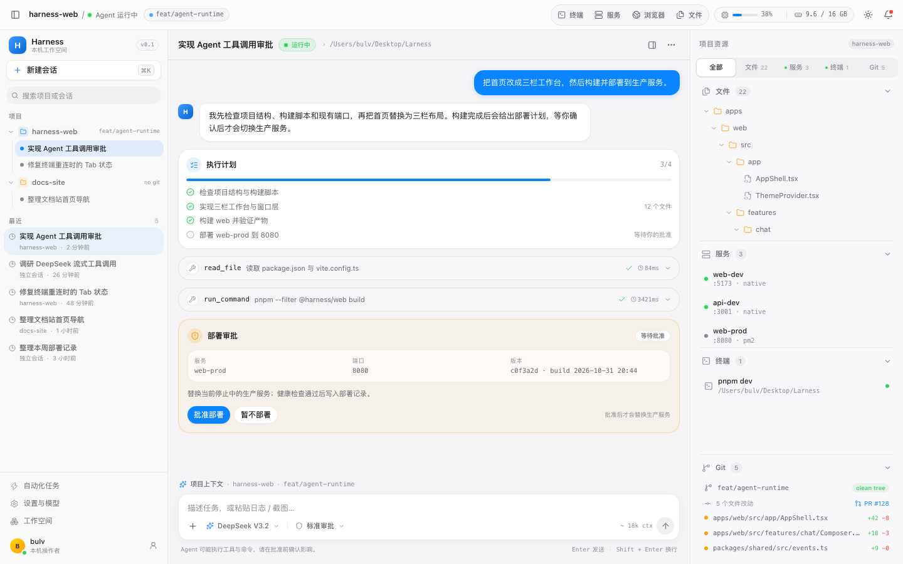
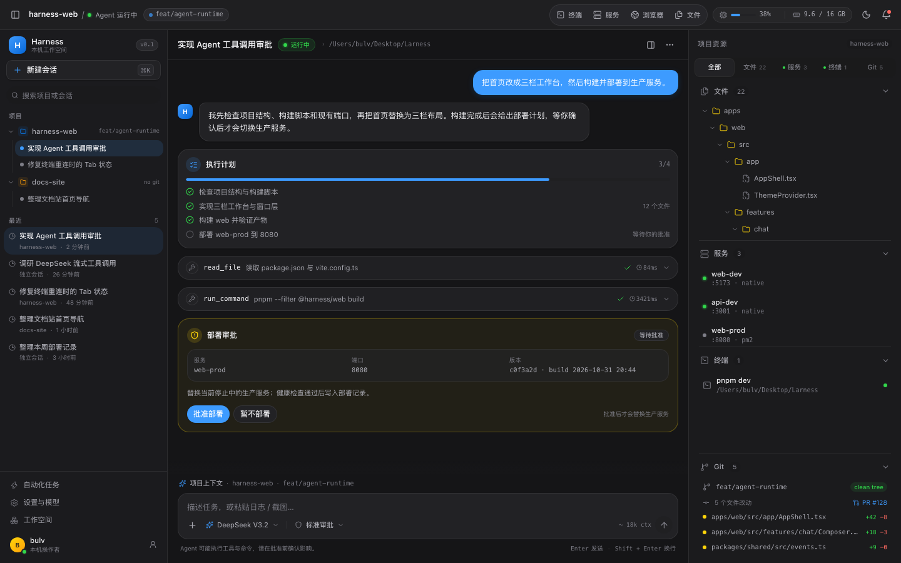
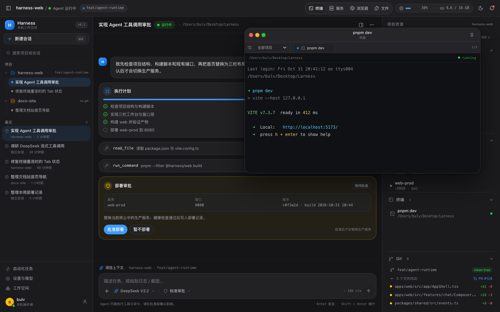
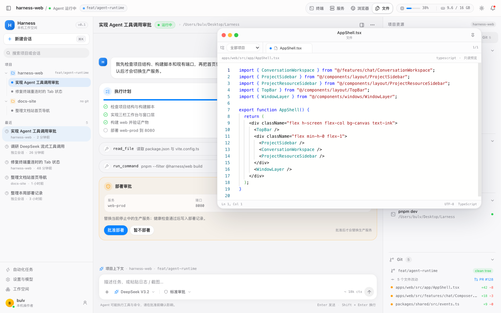
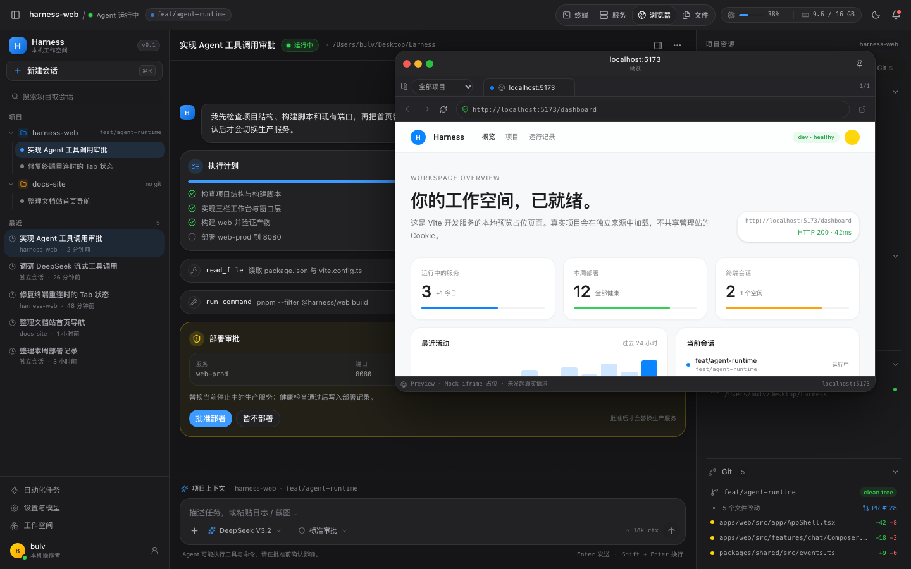
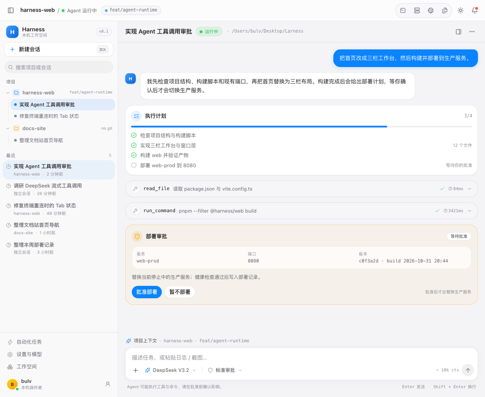
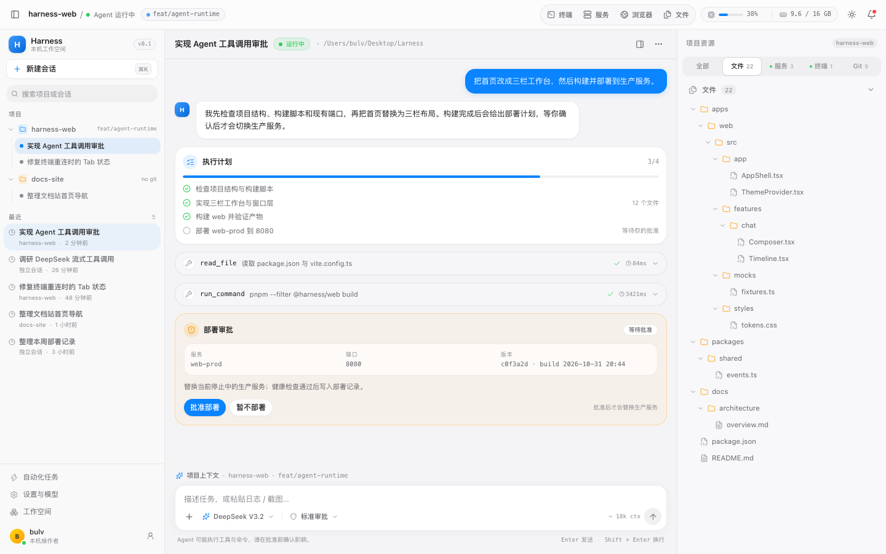
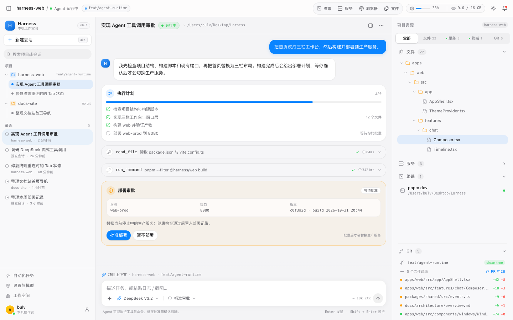
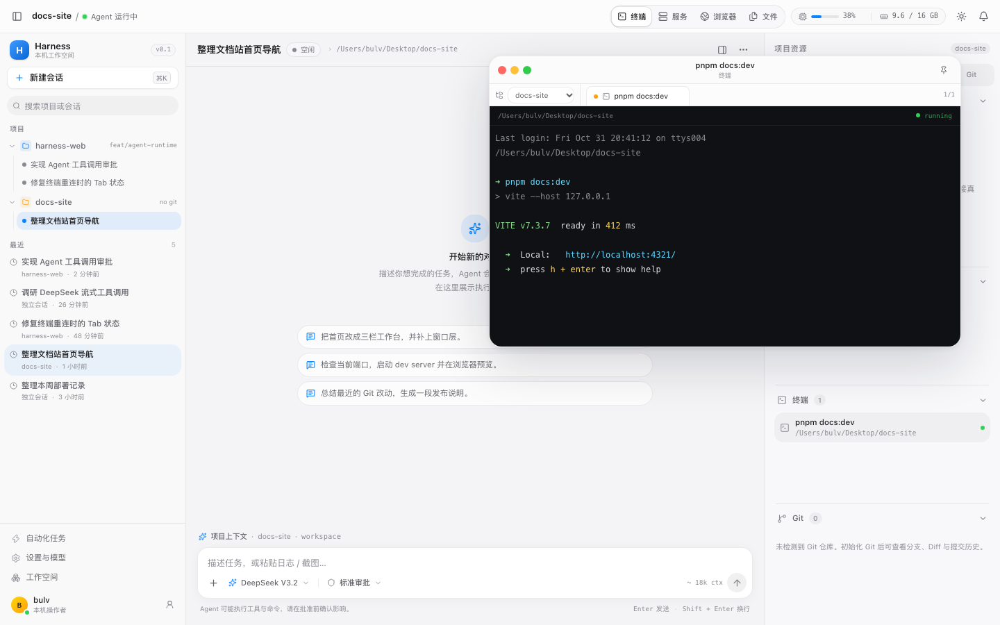

# S0 视觉 Demo 验收记录

> 日期：2026-11-01  
> 状态：**自动化通过，等待人类视觉验收**  
> 环境：macOS arm64 · Node 20.19.3 · pnpm 10.12.4 · Chromium 156（Playwright）

## 1. 如何运行

```bash
pnpm install
pnpm dev            # http://localhost:5173
pnpm check          # Biome + 类型 + 单元测试
pnpm build
pnpm test:e2e
pnpm demo:shots     # 重新生成 screenshots/ 下的截图
```

## 2. 验收结果

| 场景 | 结果 | 说明 |
|---|---|---|
| A1 三栏布局 | 通过 | 顶部 48px、左 268px、右 340px；无 Dock / 模拟标题栏 / 活动栏 |
| A2 主题 | 通过 | 浅色 / 深色 / 跟随系统；localStorage 持久化；菜单 Portal 不被裁剪 |
| A3 右侧分区 | 通过 | 四分区独立滚动、折叠、拖拽、双击均分、方向键调整 |
| A4 窗口控制 | 通过 | 红黄绿关闭 / 隐藏 / 最大化；顶部入口恢复同一窗口，不重复创建 |
| A5 输入区聚焦 | 通过 | 仅外层圆角容器显示聚焦环，textarea 无方形 outline |
| A6 Mock 对话与审批 | 通过 | 计划、工具卡片、流式回复、部署审批、批准 / 拒绝 |
| A7 键盘 | 通过 | Ctrl/Cmd+K、Ctrl/Cmd+B、Esc 隐藏最上层窗口 |
| A8 窄屏降级 | 通过 | 1100px 隐藏右栏；700px 左栏抽屉 + 顶部入口 |
| 项目切换（补充） | 通过 | 切换到 docs-site 后资源栏跟随项目并展示空态 |
| A12 窗口项目筛选 | 通过 | 筛选下拉与 Tab 同排（下拉最左）；Tab 按项目分组；从右栏自动筛选；顶部入口可恢复；筛选只隐藏不停止 |
| A13 输入区融合 | 通过 | 时间线与输入区无横向分割线；使用留白与渐变；输入框保留圆角/边框/聚焦环 |
| A11 资源区 Tabs | 通过 | 默认“全部”；单项视图占满右栏，Tab 保留计数 / 运行状态 |
| A9 视觉基线 | 通过 | 见下方截图；字体、间距、圆角、阴影按 token |
| A10 自动化回归 | 通过 | `pnpm check`、`pnpm build`、`pnpm test:e2e` 全绿 |

测试明细：

- 单元 / 组件：3 个文件、10 个用例（窗口几何、事件 reducer、主题解析）。
- E2E：14 个用例（布局、资源 Tabs、项目切换、主题、窗口、项目筛选、输入区融合、分区、折叠填充、Monaco、对话审批、快捷键、窄屏、上下文菜单与文件树折叠）。
- 控制台：无 error；无外部网络请求；fixtures 无真实秘密。

## 3. 截图

### 浅色 · 1440 × 900



### 深色 · 1440 × 900



### 终端窗口



### 文件窗口（Monaco 只读）



### 浏览器预览占位



### 窄屏 · 1100 × 900（右栏收起）



### 资源区“文件”单项视图



### 折叠“服务”后的资源区（剩余分区填满）



### 窗口项目筛选（从 docs-site 打开终端）



## 4. 已知边界

- 所有数据来自 `MockGateway`；刷新后 Mock 会话内容重置。
- 终端为 xterm.js 静态输出，不启动真实 PTY。
- 浏览器窗口是静态预览占位，不加载真实 `localhost`，不发网络请求。
- Monaco 使用本地依赖，首次打开文件窗口按需加载（约 4 MB chunk）；M2 再做按语言裁剪。
- 窗口布局、导航、主题持久化到 localStorage；右侧分区高度与“全部 / 单项”视图不持久化（Demo 语义，刷新回到“全部”）。
- 分区拖拽使用 Pointer Events；E2E 覆盖双击均分，拖拽以人工验收为准。

## 5. 待人类确认

- [ ] 视觉风格（字体密度、圆角、阴影、工具栏透明度）是否符合预期；
- [ ] 三栏比例与右侧分区初始高度是否合适；
- [ ] 对话卡片与审批卡片的信息层级是否清晰；
- [ ] 窗口默认尺寸 / 位置与层级体验是否合适；
- [ ] 是否需要调整 Mock 文案或品牌标识。

确认后：`D0-9` 标记 `done`，G-S0 通过，进入 `M0-1`。
